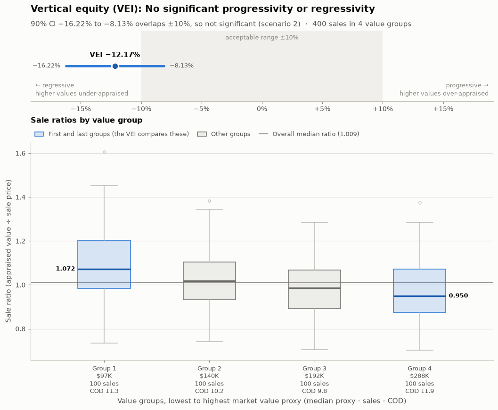
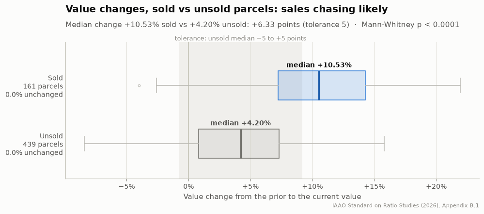
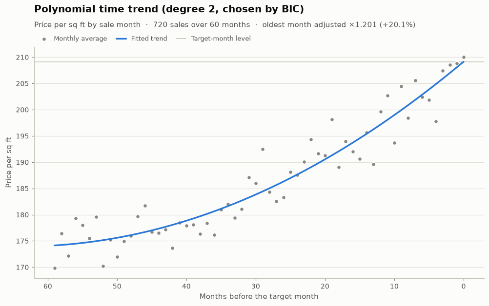

# pyRealEstate

[](https://pypi.org/project/pyRealEstate/)
[](https://pypi.org/project/pyRealEstate/)
[](https://github.com/Joshua-Data-Wizard/PyRealEstate/blob/main/LICENSE)
[](https://github.com/Joshua-Data-Wizard/PyRealEstate/actions/workflows/python-publish.yml)
[](https://pepy.tech/project/pyrealestate)


**Ratio studies for mass appraisal**

Pass in sale prices and appraised values, and get the level, uniformity and vertical-equity statistics of a ratio
study, with confidence intervals, plain-English verdicts, and tables and charts ready for a report. Then go further:
check for sales chasing, trim outliers the way the Standard describes, test whether your metrics are stable, and
trend sale prices over time.


pyRealEstate is for everyone in mass appraisal: assessors and appraisers checking their values, modelers building and
testing automated valuation models (AVMs), and oversight agencies reviewing ratio studies. It tries to follow the
IAAO's *Standard on Ratio Studies* (2026) to the best of its ability, formula by formula, and every ratio-study
function's documentation names the section it follows.

## ✨ Highlights

- **A whole ratio study in one call.** `Ratio_Study_Summary` gives the statistics of the Standard's demonstration
  report (Table 10.2), each with its 90% confidence interval and a verdict, as a clean table in your notebook.
- **Checked against the Standard's own worked examples**, number by number (see [how](https://github.com/Joshua-Data-Wizard/PyRealEstate#-how-pyrealestate-is-verified)).
- **Confidence intervals** for the median, mean and weighted mean ratios and the COD (Appendix D), and a PASS / FAIL
  test of the COD against the Standard's range for your property type (Tables 11.1 and 11.2).
- **Vertical equity:** the 2026 Vertical Equity Indicator (VEI, Appendix E) with its charts, the PRB and the PRD.
- **Model accuracy:** MAPE, MdAPE, PE10 / PE20, RMSE and R², and a **metric stability check** that shows which of them
  a few unusual sales are pushing around.
- **Sales chasing:** Appendix B's detection techniques, with charts, in their own module.
- **Outlier trimming:** the Standard's IQR method (Appendix C) and the Florida Department of Revenue's ratio limits,
  with trimmed versions of the summary for side-by-side comparison.
- **Statistical tests:** normality (Shapiro-Wilk, D'Agostino-Pearson, Anderson-Darling), Kruskal-Wallis and
  Mann-Whitney.
- **Time trending:** polynomial, machine-learning and linear models of sale price over time, with adjustment factors.
- **Careful with your data:** a sale that can't be used is left out with a clear warning that names its row, never
  silently turned into a wrong number.

## 📦 Installation

```bash
pip install pyRealEstate
```

pyRealEstate needs Python 3.10 or newer. It installs numpy, pandas, scipy, statsmodels, scikit-learn, LightGBM and
matplotlib.

## 🚀 Quick start

```python
import pandas as pd
from pyRealEstate import RealEstateMetrics as rem

sales = pd.read_csv("sales.csv")            # one row per sale

summary = rem.Ratio_Study_Summary(sales["Sale_Price"], sales["Appraised_Value"],
                                  property_type="residential")
summary                                     # in a notebook: the table below
print(summary)                              # in a script or a terminal: the same table as text
```

Here is the summary of the Standard's own 54 example sales (its Table 10.1), as a notebook shows it:

**Ratio Study Summary**: 54 sales, 90% confidence intervals. COD standard: Table 11.1, residential improved (5.0 to 15.0).

| Statistic | Value | 90% CI | Result |
|:--|--:|--:|:--|
| **Sales** | | | |
| Number of sales | 54 | | |
| Total appraised value | \$26,127,200 | | |
| Total sale price | \$29,020,600 | | |
| Average appraised value | \$483,837 | | |
| Average sale price | \$537,419 | | |
| **Level** | | | |
| Median ratio | 0.8678 | 0.7867 to 0.9840 | |
| Mean ratio | 0.8938 | 0.8350 to 0.9526 | |
| Weighted mean ratio | 0.9003 | 0.8359 to 0.9647 | |
| **Uniformity** | | | |
| COD | 24.65% | 21.878% to 28.618% | FAIL: CI entirely above 15.0 |
| Within ±15% of the median ratio (coefficient of concentration) | 31.5% | | |
| **Accuracy** | | | |
| MAPE | 23.63% | | |
| MdAPE | 23.96% | | |
| PE10 (within ±10% of the sale price) | 18.5% | | |
| PE20 (within ±20% of the sale price) | 44.4% | | |
| **Vertical equity** | | | |
| VEI | 48.53% | 29.52% to 67.54% | Progressive |
| PRB (t-value) | 0.1871 (3.113) | 0.0865 to 0.2878 | FAIL: CI entirely above 0.05 |
| PRD | 0.993 | | Within 0.98 to 1.03 |
| **Distribution** | | | |
| Normal distribution of ratios (Shapiro-Wilk, 0.05) | p = 0.1962 | | No significant departure from normality |

Every value is also an attribute (`summary.cod`, `summary.cod_lower`, `summary.pe10`, ...), and
`summary.to_frame()` gives a DataFrame for Excel or CSV. Each statistic also has its own function, shown below.

## 🧭 A tour of the library

The examples use a DataFrame `sales` with one row per sale, and import the library's modules like this:

```python
from pyRealEstate import RealEstateMetrics as rem   # ratio-study statistics, tests, trimming, the summary
from pyRealEstate import Sales_Chasing as sc        # Appendix B: sales-chasing checks
from pyRealEstate import Time_Trending as tt        # time-adjustment models
from pyRealEstate import Pre_Processing as pp       # data-quality helpers

y, x = sales["Sale_Price"], sales["Appraised_Value"]   # always the sale price first, then the appraised value
```

### Level and uniformity, with confidence intervals

```python
rem.Median_Ratio(y, x)                                 # the level the Standard prefers (Section 7.1)
rem.Median_Ratio_Lower(y, x), rem.Median_Ratio_Upper(y, x)   # its 90% confidence interval (Appendix D)
rem.Mean_Ratio(y, x), rem.Weighted_Mean_Ratio(y, x)    # the other measures of level (Sections 7.2, 7.3)
rem.COD(y, x)                                          # uniformity (Section 8.1.1)
rem.COD_Lower(y, x), rem.COD_Upper(y, x)               # its confidence interval (Appendix D.6)
rem.COD_Conclusion(y, x, "residential")                # 'PASS' or 'FAIL' against Table 11.1's 5 to 15
rem.COD_Conclusion(y, x, (5.0, 12.0))                  # or against your own local standard
rem.Coefficient_of_Concentration(y, x)                 # share of ratios within ±15% of the median (8.1.3)
```

The Standard asks for confidence intervals before concluding that a statistic is out of compliance, so the verdicts
here are built on them, not on the point estimates alone.

### Vertical equity: are low- and high-value properties treated alike?

```python
vei = rem.VEI(y, x)                     # the 2026 Vertical Equity Indicator (Appendix E)
print(vei)                              # the VEI, its confidence interval, the verdict and the value groups
vei.plot()                              # the chart below
rem.PRB(y, x), rem.PRB_Conclusion(y, x) # price-related bias and its PASS / FAIL (Section 11.2.6)
rem.PRD(y, x)                           # price-related differential
```



*Made-up data. The VEI is −12%, outside the ±10% range, but its confidence interval overlaps the range, so the
Standard does not call it significant.*

### Model accuracy, and which metrics you can trust

```python
rem.MAPE(y, x), rem.MdAPE(y, x)           # average and typical error, as a % of the sale price
rem.PE(y, x), rem.PE(y, x, within=20)     # PE10 and PE20: share of values within 10% / 20% of the price
rem.RMSE(y, x), rem.R_Squared(y, x)       # dollar-based: dominated by the most expensive sales

stability = rem.Metric_Stability_Check(y, x, stratify=sales["Neighborhood"])
stability                                 # every metric on 5 random folds, rated 🟢 🟡 🟠 🔴
```

In a market whose median home sells for \$300,000, one mis-valued \$5,000,000 sale can double a model's RMSE while
the median ratio and the COD barely move. `Metric_Stability_Check` makes that visible: it splits the sales into folds,
calculates every metric on each, and rates how far apart the folds are, so an assessor can tell a bad model from a
metric that a few sales are pulling around.

### Outlier trimming

```python
trimmed = rem.Trim_Outliers(y, x)                     # 1.5 x the interquartile range (Appendix C)
print(trimmed)                                        # the trim points, and every trimmed sale by row
rem.COD(trimmed.sale_price, trimmed.appraised_value)  # any statistic of the kept sales

rem.Ratio_Study_Summary_Trimmed(y, x, property_type="residential")   # the whole summary, trimmed
rem.Ratio_Study_Summary_Trimmed_FDOR(y, x)            # the Florida DOR's limits: ratios 0.30 to 1.70
```

Trimming follows Appendix C's worked example exactly, warns when more than 10% of the sales would be trimmed (C.5),
and states how the sales were trimmed in every trimmed summary, as the Standard asks.

### Statistical tests

```python
print(rem.Normality_Test(y, x))                         # are the ratios normally distributed? (Table 6.3)
print(rem.Kruskal_Wallis(y, x, sales["Neighborhood"]))  # are the neighborhoods appraised at the same level?
print(rem.Mann_Whitney(y, x, sales["Is_Condo"]))        # are two groups (condos and the rest)?
```

### Sales chasing (Appendix B)

```python
sc.Ratio_Concentration(y, x)                     # B.4: ratios bunched too tightly to be honest appraisal?

changes = sc.Value_Change_Comparison(parcels["Prior_Value"], parcels["Current_Value"], parcels["Sold"])
print(changes)                                   # B.1: did sold parcels' values change more than unsold ones'?
changes.plot()                                   # the chart below

sc.Unit_Value_Comparison(parcels["Current_Value"], parcels["Living_Area"], parcels["Sold"])  # B.2: value per sq ft

sc.Split_Sample_Comparison(sales["Adjusted_Price"], x, sales["Sale_Date"], "2026-01-01")   # B.3: before vs after
```



*Made-up data: sold parcels revalued about 11%, unsold ones about 4%.* The other two techniques, B.5 and B.6, use the
ratio-study functions above; the `Sales_Chasing` module's documentation explains how.

### Time trending

```python
model = tt.SPPSF_Polynomial_Time_Model()                       # the degree is chosen by BIC
model.fit(sales["Price_Per_SqFt"], sales["Months_Ago"])        # month 0 is the month you adjust to
model.Display_Time_Trend()                                     # the chart below
factors = model.Adjustment_Rate_Return(as_pandas=True)         # the adjustment factor for each month
```



`SPPSF_Machine_Learning_Time_Model` (random forest or LightGBM, with optional smoothing) and `MLR_Time_Trend` (a
straight line) work the same way.

### Preparing the data

```python
pp.Pandas_Missing_Data(sales)    # missing values in each column
pp.Constant_In_Data(sales)       # columns with a single value
pp.ID_in_Data(sales)             # columns that look like IDs (a different value in every row)
```

### Careful with your data

Every ratio-study function checks the sales first. A sale with a missing price or value, or a sale price of 0 or
less, is left out with a `DataQualityWarning` that says how many and which rows; an appraised value of 0 or less is
kept, with a warning to check it; and inputs that can't work (different lengths, no numbers) raise a clear error.
Pandas columns are paired by position, so a filtered DataFrame is safe.

## 🆕 What's new in 0.3.0

0.3.0 is the biggest release yet: the library was reviewed against the 2026 *Standard on Ratio Studies* from top to
bottom.

- **The ratio study summary:** `Ratio_Study_Summary`, its trimmed versions, and a table display for notebooks,
  scripts, markdown and Excel.
- **New statistics:** `Median_Ratio`, `Mean_Ratio`, `Weighted_Mean_Ratio`, the MAPE, MdAPE, coefficient of
  concentration, PE10 / PE20, RMSE and R².
- **Confidence intervals** for the median, mean and weighted mean ratios and the COD (Appendix D), and
  `COD_Conclusion` / `COD_Cutoff`: does the COD meet the Standard for a property type?
- **The 2026 VEI** (Appendix E), with its confidence-interval test, verdict and charts.
- **New tests:** `Normality_Test`, `Kruskal_Wallis`, `Mann_Whitney`.
- **New module `Sales_Chasing`:** Appendix B's techniques, with box plots and charts.
- **Outlier trimming:** `Trim_Outliers` (Appendix C) and `Trim_Outliers_FDOR`.
- **`Metric_Stability_Check`**, to see which metrics a few sales are driving.
- **The PRB** now always returns its coefficient, with a 90% interval by default, and `PRB_Conclusion` follows the
  Standard's confidence-interval principle.
- **Data checks** with clear warnings everywhere, faster imports, new time-trend charts, `MLR_Time_Trend` fixed,
  seaborn no longer needed, and tested minimum versions of every dependency.

## ⬆️ Upgrading from 0.2

| In 0.2 | In 0.3.0 |
|---|---|
| `VEI` followed the draft method and returned a tuple | **Breaking:** it follows the 2026 Standard (Appendix E) and returns a result object (`vei.vei`, `vei.ci_lower`, `vei.conclusion`, `vei.plot()`). Its numbers differ: to reproduce past results, use `pip install pyRealEstate==0.2.1`. |
| `DOR_SUMMARY_Statistics` | Still works, with more statistics, and warns that it is deprecated: use `Ratio_Study_Summary`. It will be removed in 0.4.0. |
| `weighted_Mean_Sale_Ratio` | Still works and warns: use `Weighted_Mean_Ratio` (the same result). It will be removed in 0.4.0. |
| `PRB` returned 0.0 when the bias was not significant; its interval was 95% | `PRB` always returns the coefficient; `PRB_Lower` / `PRB_Upper` default to 90% (`confidence_level=0.95` gives the old interval). |
| The summary noted every COD above 10 or 15 | No COD note unless you name a `property_type`, which uses the Standard's own ranges (Tables 11.1 and 11.2). |

## ✅ How pyRealEstate is verified

- **The Standard's worked examples, number by number:** its demonstration report (Table 10.2) from the 54 sales of
  Table 10.1, the confidence intervals of Appendix D, the VEI example of Appendix E, the critical concentrations of
  Table B.4.1, and the trimming example of Appendix C.
- **Independent reference implementations:** the formulas written out again, step by step from the Standard, with only
  Python's standard library (most in exact fractions), and compared with the library on thousands of samples.
- **About 3,700 tests, at both ends of what is supported:** Python 3.10 with every dependency at its oldest supported
  version, and Python 3.13 with the newest.
- **Where the Standard is silent, it says so.** When a statistic is not in the Standard (MAPE's formula, PE10, RMSE),
  or a choice had to be made (the B.3 split-sample test), the documentation says so plainly.

## 📚 Documentation

Every function has a detailed docstring: what it answers, the formula, the Standard's section, the edge cases and an
example. Use `help(rem.Ratio_Study_Summary)`, or your editor's hover. The
[wiki](https://github.com/Joshua-Data-Wizard/PyRealEstate/wiki) walks through each area:

- [Ratio Study Summary](https://github.com/Joshua-Data-Wizard/PyRealEstate/wiki/Ratio-Study-Summary)
- [AVM Evaluation Metrics](https://github.com/Joshua-Data-Wizard/PyRealEstate/wiki/AVM-Evaluation-Metrics)
- [Vertical Equity](https://github.com/Joshua-Data-Wizard/PyRealEstate/wiki/Vertical-Equity)
- [Statistical Tests](https://github.com/Joshua-Data-Wizard/PyRealEstate/wiki/Statistical-Tests)
- [Outlier Trimming](https://github.com/Joshua-Data-Wizard/PyRealEstate/wiki/Outlier-Trimming)
- [Metric Stability Check](https://github.com/Joshua-Data-Wizard/PyRealEstate/wiki/Metric-Stability-Check)
- [Sales Chasing](https://github.com/Joshua-Data-Wizard/PyRealEstate/wiki/Sales-Chasing)
- [Time Trending](https://github.com/Joshua-Data-Wizard/PyRealEstate/wiki/Time-Trending)
- [Pre Processing](https://github.com/Joshua-Data-Wizard/PyRealEstate/wiki/Pre-Processing)
- [Data Checks](https://github.com/Joshua-Data-Wizard/PyRealEstate/wiki/Data-Checks)
- [What's New in 0.3.0](https://github.com/Joshua-Data-Wizard/PyRealEstate/wiki/Whats-New-in-0.3.0)

## 🤝 Contributing

Questions, ideas and bug reports are very welcome: please
[open an issue](https://github.com/Joshua-Data-Wizard/PyRealEstate/issues). If something in the library doesn't match
the Standard, or your jurisdiction does something differently, we would love to hear about it.

## ⚖️ Independence

pyRealEstate is an independent open-source project. It is **not affiliated with, endorsed by, or sponsored by the
International Association of Assessing Officers (IAAO)**. The *Standard on Ratio Studies* is the IAAO's publication;
pyRealEstate tries to follow it to the best of its ability, and any mistake is the library's own. The statistics are
tools to support professional judgment, not a replacement for it.

## 📄 License

[MIT](https://github.com/Joshua-Data-Wizard/PyRealEstate/blob/main/LICENSE)
